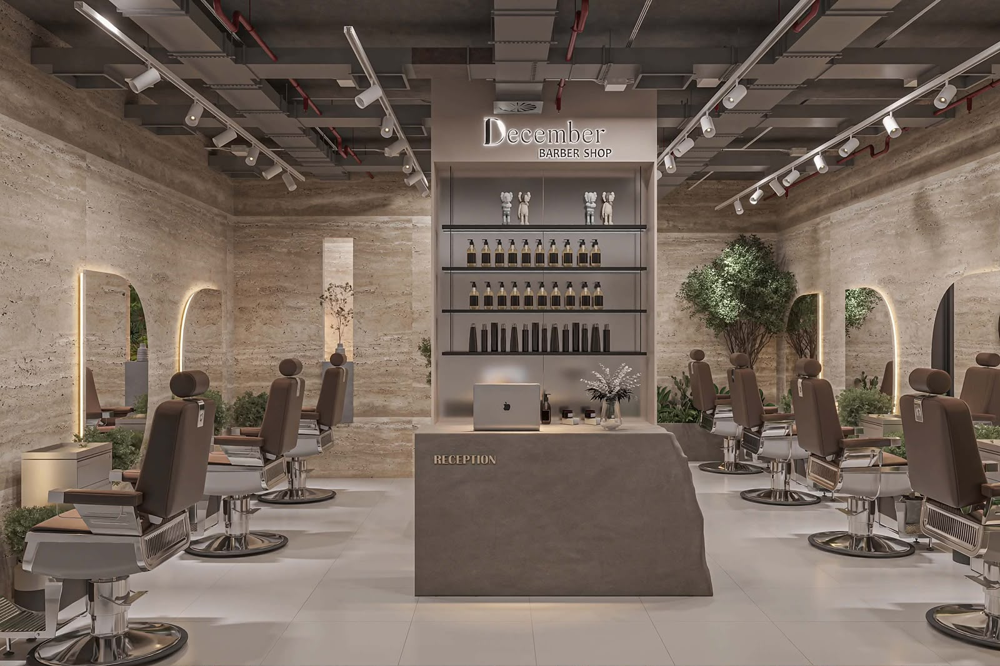

<div align="center">
  
  <h1>DECEMBER BARBER SHOP</h1>
  <p>
    <strong>The Art of the Gentleman · Prague</strong><br />
    <em>Luxury barbershop platform — bilingual Czech (<code>/cs</code>) &amp; English (<code>/en</code>) web experience, shared design system, and upcoming booking backend.</em>
  </p>

  <p>
    
    
    
    
    
    
    
  </p>
</div>

<p align="center">
  
</p>

---

## ✨ Tổng quan dự án

**December Barber Shop** là nền tảng web cho chuỗi barbershop cao cấp tại **Praha (Cộng hoà Séc)**, được tổ chức dưới dạng monorepo (`pnpm` + `Turborepo`) nhằm dùng chung domain types, design tokens và thư viện UI giữa landing page, trang quản trị và hệ thống API đặt lịch.

### Kiến trúc Monorepo

| Workspace                            | Tên package        | Vai trò                                                                              |     Trạng thái     |
| :----------------------------------- | :----------------- | :----------------------------------------------------------------------------------- | :----------------: |
| [`apps/web`](apps/web)               | `@december/web`    | Landing page song ngữ **CS / EN** (Next.js 16 App Router, Tailwind v4, GSAP, Motion) | ✅ **Giai đoạn 1** |
| [`apps/api`](apps/api/README.md)     | `@december/api`    | Backend NestJS (booking chống trùng slot, lịch thợ, thanh toán, CMS, thông báo)      | ⏳ **Giai đoạn 2** |
| [`apps/admin`](apps/admin/README.md) | `@december/admin`  | Dashboard quản trị vận hành (lịch hẹn, ca thợ, dịch vụ, khách hàng, nội dung)        | ⏳ **Giai đoạn 2** |
| [`packages/ui`](packages/ui)         | `@december/ui`     | Thư viện UI primitive dùng chung (`Container`, `Eyebrow`, `cn`)                      |    ✅ Sẵn sàng     |
| [`packages/types`](packages/types)   | `@december/types`  | Domain types dùng chung `web ↔ api ↔ admin` (`Service`, `Booking`, `SiteConfig`…)    |    ✅ Sẵn sàng     |
| [`packages/config`](packages/config) | `@december/config` | Cấu hình TypeScript chuẩn & brand tokens Tailwind (`tailwind/brand.css`)             |    ✅ Sẵn sàng     |
| [`sources`](sources)                 | —                  | Bộ logo, wordmark và ảnh render gốc (read-only)                                      |     📦 Assets      |

---

## 🎨 Ngôn ngữ thiết kế & Trải nghiệm (`apps/web`)

Website được thiết kế theo phong cách **Quiet Architectural Luxury** — lấy cảm hứng từ đá travertine, da nâu cổ điển, ánh sáng ấm và mảng cây xanh nội thất.

### Bảng màu & Typography thương hiệu

| Token        | Hex       | Vai trò                                        |
| :----------- | :-------- | :--------------------------------------------- |
| `ivory`      | `#F6F2EC` | Nền sáng chính                                 |
| `bone`       | `#EDE6DC` | Bề mặt thẻ / hover trên nền sáng               |
| `travertine` | `#D9CBB8` | Nền section Experience                         |
| `leather`    | `#6B4A3A` | Nhãn phụ & đường nhấn trên nền sáng            |
| `espresso`   | `#2B211C` | Nền tối ấm (Menu, Contact, Preloader)          |
| `ink`        | `#17120F` | Nền tối sâu & chữ chính trên nền sáng          |
| `gold`       | `#D9C27A` | Điểm nhấn champagne gold (logo, CTA, progress) |

- **Display Font:** `Cormorant Garamond` (`--font-cormorant` → `--font-display`, hỗ trợ `latin-ext` cho dấu tiếng Séc `č, ř, ž, ů…`)
- **Body Font:** `Manrope` (`--font-manrope` → `--font-sans`, hỗ trợ `latin-ext`)

### Cấu trúc Landing Page (`src/app/[locale]/page.tsx`)

1. **`Hero`** — Toàn màn hình với ảnh quầy lễ tân, parallax theo cuộn, tiêu đề `SplitReveal`, nút CTA từ tính (`Magnetic`) và cue hướng dẫn cuộn.
2. **`Styles`** — Sân khấu trình diễn **5 kiểu tóc Signature** (`Textured Quiff`, `Modern Taper`, `Beard & Fade`, `Slick Back`, `Natural Flow`); mỗi kiểu tự động chuyển bảng màu toàn section, ảnh mở rèm, thanh tiến độ tự chuyển 6 giây và đồng bộ màu chữ cho `Header` / `SectionRail`.
3. **`Menu`** — Bảng giá dịch vụ tương tác với tab lọc danh mục (Motion `layoutId` pill), xem trước ảnh dạng vòm (`arch`) sticky trên desktop và định dạng tiền tệ `CZK` theo ngôn ngữ.
4. **`Gallery`** — Lưới 3 cột ảnh nội thất thực tế chạy lệch tốc độ khi cuộn + lightbox toàn màn hình hỗ trợ bàn phím (`Esc`, `←`, `→`).
5. **`Experience`** — 4 trụ cột trải nghiệm dịch vụ, khung ảnh mở rộng theo cuộn và bộ đếm thông số (`prefers-reduced-motion` compliant).
6. **`Contact`** — Chữ `D` vector tự vẽ nét theo tiến độ cuộn, CTA đặt lịch (Gọi điện / WhatsApp / Google Maps), giờ mở cửa và bản đồ Praha nhúng trực tiếp.

### Kiến trúc Motion & SEO

- **Native Scrolling Only:** Không dùng smooth-scroll JS / Lenis hay `pin: true` gây trễ phản hồi con lăn chuột.
- **Chuyển cảnh tập trung:** `SectionTransitions` điều phối hiệu ứng section trồi lên (`rounded-t` rise), lớp phủ tối dần và theo dõi `useActiveSection()` để đổi theme cho `Header` & `SectionRail`.
- **i18n & SEO:** Routing `/cs` (mặc định qua `src/proxy.ts` theo `Accept-Language`) và `/en`; có `LocalBusiness` JSON-LD (`@type: "BarberShop"`), dynamic `opengraph-image.tsx` theo locale, `sitemap.ts` và `robots.ts`.

---

## 📂 Cấu trúc thư mục `apps/web/src`

```text
apps/web/src/
├── app/
│   ├── [locale]/
│   │   ├── layout.tsx          # Fonts (Cormorant Garamond, Manrope), Metadata, Providers
│   │   ├── page.tsx            # Landing page 6 sections + JSON-LD
│   │   ├── opengraph-image.tsx # Dynamic OG image theo locale
│   │   └── not-found.tsx
│   ├── globals.css             # Tailwind v4 + brand.css + tokens + keyframes
│   ├── robots.ts
│   └── sitemap.ts
├── components/
│   ├── brand/                  # LogoD (vector SVG, .logo-d__strand animate), Wordmark
│   ├── layout/                 # Header, MenuOverlay, LanguageSwitch, SectionRail, Section, Footer
│   ├── motion/                 # Preloader, SectionTransitions, Reveal, SplitReveal, Parallax, ClipReveal, Magnetic, Marquee
│   └── sections/               # Hero, Styles, Menu, Gallery, Experience, Contact
├── content/                    # Dữ liệu tiệm (site.ts, hair.ts, services.ts, images.ts, experience.ts, testimonials.ts)
├── i18n/                       # config.ts, dictionaries/{cs,en}.ts, DictionaryProvider
├── hooks/                      # useReducedMotion, useMediaQuery
├── lib/                        # gsap.ts, scroll.ts, active-section.ts, seo.ts, cn.ts
└── proxy.ts                    # Redirect "/" → "/cs" hoặc "/en"
```

---

## 🤖 Hệ thống AI Agents & Workspace Skills

Dự án tích hợp sẵn bộ chuyên gia AI chuyên biệt cho cả **Claude Code** (`.claude/agents/`) và **Antigravity** (`.agents/skills/`):

| Vai trò               | Claude Code Agent      | Antigravity Skill          | Nhiệm vụ chính                                                       |
| :-------------------- | :--------------------- | :------------------------- | :------------------------------------------------------------------- |
| **Art Direction**     | `design-director`      | `december-design-director` | Kiểm soát thẩm mỹ luxury, typography, contrast, layout rhythm        |
| **UI Library**        | `ui-library-architect` | `december-ui-library`      | Tách và chuẩn hoá component dùng chung trong `@december/ui`          |
| **QA / A11y / CWV**   | `frontend-qa-a11y`     | `december-qa-cwv`          | Kiểm tra WCAG AA, LCP/CLS, SEO, `prefers-reduced-motion`, responsive |
| **Section Builder**   | `section-builder`      | —                          | Dựng/chỉnh sửa section theo đúng quy ước brand, GSAP và i18n         |
| **Motion Reviewer**   | `motion-reviewer`      | —                          | Audit hiệu năng animation, ScrollTrigger cleanup, native scroll      |
| **Conversion UX**     | `conversion-ux`        | —                          | Tối ưu hành trình từ xem kiểu tóc / bảng giá sang đặt lịch           |
| **i18n Translator**   | `i18n-translator`      | —                          | Đồng bộ bản dịch tự nhiên tiếng Séc (`cs`) và tiếng Anh (`en`)       |
| **Backend (Phase 2)** | `nestjs-architect`     | —                          | Thiết kế & triển khai `apps/api` (NestJS, Prisma, booking slots)     |
| **Admin (Phase 2)**   | `admin-builder`        | —                          | Thiết kế & xây dựng portal quản trị `apps/admin`                     |

> Quy ước chi tiết cho AI agents được ghi tại [`CLAUDE.md`](CLAUDE.md) và [`AGENTS.md`](AGENTS.md).

---

## 🚀 Cài đặt & Chạy local

### Yêu cầu

- **Node.js** `>= 20.11`
- **pnpm** `10.x` (`corepack enable` hoặc chạy trực tiếp qua `npx -y pnpm@10.34.9`)

### Chạy dự án

```bash
# 1. Clone repository
git clone https://github.com/PhuThanhz/DECEMBER-HAIR-BARBERSHOP.git
cd DECEMBER-HAIR-BARBERSHOP

# 2. Cài dependencies
pnpm install

# 3. Khởi động dev server (http://localhost:3000)
pnpm dev
```

### Các lệnh kiểm tra chất lượng

```bash
pnpm lint        # ESLint trên toàn bộ workspace
pnpm typecheck   # TypeScript strict check (types, ui, web)
pnpm build       # Production build (Next.js Turbopack)
pnpm format      # Prettier + tailwindcss class sorting
```

Mọi PR / push lên `main` đều được kiểm tra tự động qua GitHub Actions ([`.github/workflows/ci.yml`](.github/workflows/ci.yml)) và pre-commit hook ([`.husky/pre-commit`](.husky/pre-commit)).

---

## 🗺️ Lộ trình & Checklist trước khi Go-Live

### Giai đoạn 1 — Landing Page (`apps/web`)

- [x] Monorepo `pnpm` + `Turborepo` + shared packages (`@december/config`, `@december/types`, `@december/ui`)
- [x] Giao diện song ngữ `cs` / `en` với `Cormorant Garamond` + `Manrope` (`latin-ext`)
- [x] Hệ thống motion native-scroll (Preloader, SplitReveal, Parallax, ClipReveal, SectionTransitions)
- [x] SEO metadata, dynamic OpenGraph image theo locale, `LocalBusiness` JSON-LD, `sitemap.xml`, `robots.txt`
- [ ] Thay các thông tin `// TODO` trong `apps/web/src/content/site.ts` (SĐT, email, địa chỉ Praha, link Google Maps, MXH)
- [ ] Cập nhật bảng giá thật (`services.ts`), đánh giá thật (`testimonials.ts`) và bộ ảnh chụp kiểu tóc thực tế của tiệm (`hair.ts`)
- [ ] Thiết lập biến môi trường `NEXT_PUBLIC_SITE_URL` theo domain production (xem `apps/web/.env.example`)

### Giai đoạn 2 — Booking Online & Quản trị

- [ ] Triển khai backend NestJS tại `apps/api` (đặt lịch chống trùng slot, lịch làm việc barber, thông báo & CMS)
- [ ] Xây dựng dashboard `apps/admin` dùng chung `@december/ui` và `@december/types`
- [ ] Tích hợp form đặt lịch trực tiếp từ landing page (`Styles` / `Menu` → `Contact`)
